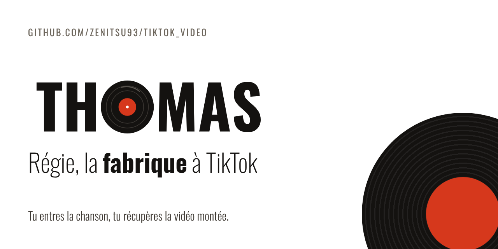

<p align="center">
  
</p>

# Régie

Régie fabrique mes TikToks « l'histoire derrière la chanson ». Je tape le titre et l'artiste, et je récupère une vidéo verticale montée, avec ma voix, les images et le texte qui s'écrit au rythme de ce que je dis.

Ensuite je relis. Le script s'affiche phrase par phrase, et chaque phrase est un plan de la vidéo. Je clique dessus, l'aperçu saute au bon moment, et je change ce qui ne va pas : l'image, le mot en grand, l'effet d'entrée, le texte. Quand j'exporte à nouveau, seuls les plans modifiés repassent au rendu. Le reste vient du cache.



## Ce que ça fait

1. Claude écrit l'histoire, avec recherche web et sources. Je la relis sur une page de lecture : je corrige à la main ou je demande une réécriture, puis je valide. Rien de payant (voix, images) ne part avant.
2. Claude découpe le script validé en plans, avec le rythme du skill de montage : à peu près un plan sans image sur quatre, une image tenue sur un à trois plans, quelques mots en italique pour varier.
3. ElevenLabs lit tout le script d'une traite avec ma voix (voice id `AYfOkr1hDQYbhigmRZ16`). La prise est ensuite coupée dans les pauses, un morceau par plan, donc l'intonation ne repart pas à zéro tous les trois mots.
4. Apify va chercher des images sur Pinterest, Deezer donne la pochette.
5. HyperFrames monte chaque plan en 1080×1920, en Kaneda Gothic, fond blanc. La vidéo s'ouvre et se ferme sur la « Pochette » : le vinyle sort de la pochette de la chanson, avec le titre et l'artiste. ffmpeg colle les plans et pose la voix.

Si la connexion lâche pendant une génération, la tâche réessaie toute seule. Si elle finit quand même en erreur, le bouton « Reprendre » repart de là où elle s'était arrêtée.

Kaneda Gothic est dans le dépôt (`brand/fonts/kaneda/`, voir son README). Ce n'est pas une police libre : garde le dépôt privé. L'app, elle, reste en Oswald.

Corriger un plan ne relance pas tout. Changer une image, un effet ou le mot en grand ne coûte rien : aucun appel à un modèle. Changer le texte refait la voix de cette phrase seulement. Une consigne à Claude (« @b08 une photo plus vieille ») n'envoie que la phrase et ses deux voisines, pas tout le script.

## Les écrans

- **Quelle chanson ?** : l'écran d'accueil, pensé pour le téléphone. Titre, artiste, un angle si j'en ai un, et c'est parti. Le titre s'écrit lettre par lettre comme dans les vidéos, et les champs vides proposent des exemples de chansons.
- **Lecture** : le script en un seul texte, avant tout ce qui coûte. Je corrige, je demande une réécriture à Claude, puis « Valider le script ».
- **Le Fil** : le script est l'interface. À gauche les phrases, à droite l'aperçu en direct dans un cadre de téléphone et ce que la vidéo a coûté. Un clic ouvre un plan, un deuxième clic le referme. Chaque plan peut passer en italique. L'aperçu passe en plein écran. En bas, la barre de correction (touche `/`). Les flèches haut et bas passent d'une phrase à l'autre. « Annuler » revient à l'état d'avant, à chaque fois.
- **Conso** : ce que coûtent Claude, ElevenLabs et Apify sur 7, 14 ou 30 jours, par jour et par vidéo, face aux plafonds.

Le bouton « Envoyer sur TikTok », à côté de « Télécharger MP4 », met le dernier export dans ma boîte de réception TikTok, sans musique. J'ouvre la notification dans l'app TikTok, j'ajoute le son, et je publie. Il faut d'abord connecter TikTok une fois (bouton « Connecter TikTok »). La marche à suivre sur le portail développeur TikTok est plus bas.

Le bouton « Supprimer » (sur la vidéo, sur la page de lecture et sur chaque ligne de l'accueil) demande une confirmation. Il efface la vidéo, ses versions et les fichiers que plus rien n'utilise. L'historique des dépenses, lui, reste.

Chaque nuit, les vidéos qui n'ont pas bougé depuis 30 jours partent de la même façon, pour que le disque du serveur ne se remplisse pas. Le délai se règle avec `RETENTION_DAYS` (0 garde tout). Une vidéo en cours de génération ou de rendu n'est jamais touchée.

## Lancer en local

Il faut Node 22, pnpm 10, Postgres 16 et ffmpeg.

```bash
pnpm install
cp .env.example .env        # puis remplis SESSION_SECRET et MEDIA_SECRET (openssl rand -base64 48)
pnpm db:migrate
pnpm dev                    # l'app sur http://localhost:3000 et le worker
```

Avec `DEV_LOGIN=1` dans `.env`, la page de connexion propose « Entrer en local ». Sans clés, chaque service tourne en mode démo : voix muette, images en dégradé, script d'exemple. Ça suffit pour essayer tout le parcours.

Avec Docker : `docker compose up --build`.

Sous Windows, si Postgres refuse le port 5432, mets `DB_PORT=55432` dans `.env` et le même port dans `DATABASE_URL`.

## En ligne

Régie tourne sur mon VPS, à l'adresse https://regie.2nbdigital.com. Chaque fusion sur `main` passe les tests, publie l'image Docker sur ghcr.io et met le VPS à jour tout seul. Le détail est dans [deploy/README.md](deploy/README.md).

## Les clés

Elles vont dans les variables d'environnement du serveur, et nulle part ailleurs. Jamais dans le code, jamais dans le navigateur.

| Variable | Sert à |
| --- | --- |
| `ANTHROPIC_API_KEY` | écrire et retoucher le script (modèle `claude-opus-5-5` par défaut, changeable avec `CLAUDE_MODEL`) |
| `ELEVENLABS_API_KEY` | la voix |
| `APIFY_TOKEN` | les images Pinterest |
| `GITHUB_CLIENT_ID`, `GITHUB_CLIENT_SECRET` | la connexion, obligatoire en production |
| `TIKTOK_CLIENT_KEY`, `TIKTOK_CLIENT_SECRET` | l'envoi dans la boîte TikTok (facultatif) |
| `BUDGET_DAY_USD`, `BUDGET_VIDEO_USD` | les plafonds de dépense (5 $ par jour, 2 $ par vidéo par défaut) |
| `RETENTION_DAYS` | le délai avant la suppression automatique d'une vidéo qui n'a pas bougé (30 jours par défaut, 0 pour tout garder) |

Pour TikTok, l'app se crée sur [developers.tiktok.com](https://developers.tiktok.com), en mode Sandbox, avec Login Kit et Content Posting API, et le seul scope `video.upload` en plus de `user.info.basic`. Mon compte TikTok est ajouté dans « Target users ». La Redirect URI est `https://ton-domaine/auth/tiktok/callback`, forcément en https. Les pages demandées par le portail existent déjà : `/legal/conditions` et `/legal/confidentialite`. L'icône 1024 × 1024 est `brand/icones/icon-1024.png`. Si le portail demande de vérifier l'adresse, le fichier `tiktok….txt` qu'il donne va dans `apps/web/public/`. TikTok accepte cinq envois en attente au plus par 24 heures. Les jetons TikTok sont chiffrés dans la base et ne sortent pas du serveur.

Pour l'app OAuth GitHub, l'URL de callback est `https://ton-domaine/auth/github/callback`.

L'acteur Pinterest reçoit `searchQueries` et `maxPins` (6 épingles par recherche). Sans `maxPins`, il en facture 50.

## Sécurité

- Une seule personne entre : le compte GitHub `OWNER_GITHUB_LOGIN`. La session est un jeton signé dans un cookie httpOnly.
- Chaque route vérifie la session, et toute modification doit venir de l'app elle-même (contrôle de l'origine).
- Les entrées sont validées avec zod, avec des tailles maximales.
- L'aperçu tourne dans un cadre isolé, sans origine : il ne voit ni les cookies ni l'API. Les images, la voix et les MP4 passent par des liens signés qui expirent.
- Les images ne sont téléchargées que depuis Pinterest et Deezer, en HTTPS, avec une taille maximale, puis ré-encodées avant usage.
- Content-Security-Policy avec nonce, HSTS, pas d'iframe externe.
- Les clés restent côté worker. L'app web ne fait que mettre des tâches en file.

Le détail est dans [SECURITY.md](SECURITY.md).

## Organisation

```
apps/web         l'app Next.js (écrans, API, aperçu)
apps/worker      Claude, voix, images, rendu HyperFrames
packages/core    le modèle d'une vidéo, le minutage et la composition HTML
packages/db      Postgres (drizzle) : vidéos, versions, fichiers, coûts
packages/server  configuration, stockage, liens signés, file de tâches, budget
brand            logo, version animée, icônes, aperçus réseaux, polices Oswald et Kaneda
skills           les skills d'écriture et de montage, et le module Pochette
deploy           la mise en ligne sur le VPS : docker compose, Caddy, script de déploiement
```

Le dossier `skills/` a son propre [README](skills/README.md). Il explique comment générer une Pochette sur ton PC avec `pochette.py`.

## La marque

Le logo s'appelle « Le Sillon » : THOMAS en Oswald, avec le O en vinyle. Tout est dans `brand/` :

- `logo/` : le logo en SVG et PNG, sur fond clair et sombre, et l'avatar TikTok.
- `anime/` : la version animée (SVG, MP4, GIF) et la boucle.
- `icones/` : favicons, icônes d'app, icône masquable.
- `reseaux/` : les aperçus de lien (1200×630) et la cover GitHub.
- `fonts/` : Oswald, sous licence SIL Open Font License, et Kaneda Gothic (commerciale, pour les vidéos seulement).

`node brand/scripts/build-brand.mjs` régénère les PNG, le MP4 et le GIF.
